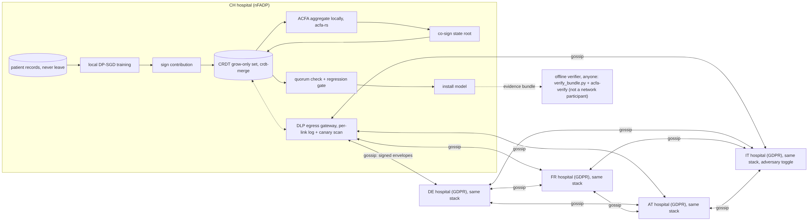

# Sovereign Hospital Federation

**Five hospitals in five jurisdictions train one model with no central server. No patient record leaves its hospital, every hospital aggregates and verifies the round itself, and every round leaves evidence that anyone can check offline.**

[](https://huggingface.co/spaces/Optitransfer/sovereign-hospital-federation)
[](LICENSE)
 

Five simulated peers take part: CH (nFADP), and DE, FR, AT and IT (EU GDPR). Four are honest and IT is a toggleable adversary. They train a 738-parameter clinical-risk MLP on **synthetic** patient tables.

**There is no coordinator, aggregator, relay or leader.** The hospitals form a full mesh:
- **Gossip over a CRDT.** Each hospital signs its contribution and gossips it, as an envelope in a grow-only set, using [crdt-merge](https://pypi.org/project/crdt-merge/) (`CRDTMergeState`, PyPI dependency). The union is commutative, associative and idempotent. Any delivery order, duplicates, delays or a healed partition therefore give every node the same set and the same state hash (proved in Lean, tested under adversarial delivery).
- **Local aggregation.** Every hospital runs [acfa-rs](https://github.com/mgillr/acfa-rs/tree/d19fb56b043ddad3ac0448ed9ceede51ba6c2c47) itself on the set it holds (Apache-2.0, pinned at `d19fb56`, unmodified). It derives a byte-identical receipt and verifies that receipt with the upstream `acfa-verify`.
- **A quorum of co-signed roots.** Each hospital signs (state root, output root, receipt hash, candidate model hash, leaf set) and gossips the co-signature. A model is accepted only when **Q = 4 of 5** hospitals signed the same root. Because 2Q > n + f with f = 1, two different roots can never both reach a quorum (`Quorum.unique_root`).
  - A node that closed early on a partial set recomputes on the quorum's leaf set.
  - A node whose signed root does not follow from its own declared leaves is flagged as **divergent**.
  - Equivocation (two signed contributions in one round) is seen by every peer in the CRDT.
- **Peer trust.** Evidence of misbehaviour lowers a peer's score in crdt-merge's E4 trust feature, through its public `TypedTrustScore` API only. At ≤ 0.1, every honest node quarantines that peer from later rounds.
- **Per-node gate and install.** Every hospital gossips a signed eval report and applies the regression gate itself. It installs only if the gate passes **and** its own `acfa-verify` exits 0.
- **Egress.** Every byte that leaves a hospital goes through one logged, DLP-scanned egress function, with a per-link log and a per-link canary scan.

> Synthetic data and throwaway keys generated at runtime. This is a technical demonstration. It isn't legal advice and doesn't claim regulatory compliance. See [threat-model.md](threat-model.md).

## Architecture



The per-round sequence ([round.png](docs/diagrams/round.png)) and the proof map ([proofmap.png](docs/diagrams/proofmap.png)) are in [docs/ARCHITECTURE.md](docs/ARCHITECTURE.md). The Mermaid sources are in [docs/diagrams/](docs/diagrams/).

## Two modes and their honest trade-off

| | **Robust mode**: each node runs ACFA multi-Krum | **Blind mode**: each node sums the masked set |
|---|---|---|
| Peers see individual updates | yes (DP-noised) | **no** (pairwise X25519 masks; TV ≤ ‖x‖₁/2R ≈ 1e-3) |
| Per-update robust filtering | **yes**: multi-Krum f=1 keeps m = n−f−2 (2 of 5) | **no**: exact mean of all admitted |
| Out-of-bound attacker | not selected | aggregate bound or gate fails → peer-to-peer commit-and-open → excluded, re-masked, quarantined |
| Within-bound attacker | not filtered if inside the honest spread | not filtered |
| Norm-bound proof | n/a | signed hiding commitment + commit-and-open dispute (**not zero-knowledge**; openings go to all peers) |
| Dropouts | quorum after a deadline | re-mask over the survivors (not Bonawitz seed recovery) |

**Why robust mode keeps only 2 of 5, and the gate rollbacks.** Multi-Krum keeps m = n − f − 2 updates by definition. With non-IID hospitals the same central sites tend to win, and some honest sites are rarely or never selected. The per-site counts are shown in the UI ("Trust & robustness" tab) and in `evaluation.json`.

Averaging only two non-IID updates can lower a third site's own accuracy past the gate's 2-point tolerance (about 600 local test rows, standard error ≈ 1.5 points). That caused the earlier rollbacks at rounds 5 and 7. The fix is a learning rate decaying as 1/√round. In the 7-round measurement it leaves **one rollback in 28 robust rounds** (no DP, no adversary, round 4, IT −3.3 pts); without the decay, no-DP robust runs roll back rounds 5 and 7. A rollback installs nothing.

## Claims: what is proved, and what isn't

| Claim | Status | Evidence |
|---|---|---|
| No coordinator: every message is a direct hospital-to-hospital link | **Shown per run**; checked by `verify_bundle.py` | `network-egress.log` |
| Gossip converges: same delivered set → same state on every node, whatever the order, duplicates or delays | **Proved in Lean** (`Crdt.same_set_same_state`, `reorder_invariant`, `duplicate_invariant`, `merge_replicas`), **tested** with shuffled, duplicated and delayed delivery and healed partitions | `mesh.json` (per-tick state hashes) |
| At most one root can be accepted | **Proved in Lean** (`Quorum.intersection`, `unique_root`, `demo_quorum_ok`) | `rounds/*/cosignatures.json` |
| Every honest node derives the byte-identical receipt and installs the identical model | **Shown** (sha256 per node); order-independence proved in Lean | `model-manifest.json` |
| An unhealed partition (or more than f faults) installs nothing | **Shown** (fail-safe test) | test `test_partition_that_never_heals_fails_safe_without_install` |
| No patient row is received by any peer | **Shown per run**: every byte is scanned per link, and `verify_bundle.py` re-scans it | `network-egress.log`, `egress-payloads/` |
| A node that leaks rows is caught | **Shown**: its message is blocked at its own gateway and never delivered | `adversarial-report.json` |
| The aggregate is exactly the stated rule over the shown set | **Proved by receipt** (acfa-rs), re-verified by upstream `acfa-verify` on every node and offline | `rounds/*/receipt.acfa`, `verification.txt` |
| Equivocation, forged signatures, lying roots and out-of-bound updates are detected and the peer is quarantined | **Shown** (tests per adversary) | `peer-trust.json`, `adversarial-report.json` |
| Tampering (receipt, model, key, manifest, co-signature, log, budget) is detected | **Shown** (negative tests) | `verification.txt` |
| Masks cancel, so blind mode computes the exact mean | **Proved in Lean** (`SecAgg.masks_cancel`) and tested | `proofs/` |
| Accepted models don't regress by more than tol | **Proved in Lean** (`Gate.gate_accept_no_regression`), enforced on every node | `evaluation.json` |
| Budget cap is never exceeded | **Proved in Lean** (`Budget.budget_halt_safe`) for the halting rule; halt shown at round 14 | `privacy-budget.json` |
| Record-level (ε, δ)-DP per hospital | **Accounted** (RDP, matches opacus). **The DP mechanism isn't formally verified** | `privacy-budget.json` |
| Membership inference ≈ chance; protection is causal | **Measured** (evidence, not proof) | `membership-inference.json`, `privacy-attacks.json` |
| Hospital-level privacy, OS/network isolation, real network asynchrony, legal compliance, ZK norm proofs | **Not claimed** | [threat-model.md](threat-model.md) |

## Measured

These numbers come from `python scripts/measure.py` on CPU in this repo (seed 7, 7 rounds; the whole mesh is simulated in one process). The full output is in [docs/measurements.json](docs/measurements.json).

| | robust, no DP | robust, DP | blind, no DP | blind, DP |
|---|---|---|---|---|
| accuracy on the common benchmark, before → after (adversary *poison*) | 0.486 → 0.837 | 0.486 → **0.837** | 0.486 → 0.837 | 0.486 → **0.836** |
| accuracy, no adversary | 0.486 → 0.835 | 0.486 → 0.837 | 0.486 → 0.839 | 0.486 → 0.835 |
| median round time | 0.20 s | 0.23 s | 0.19 s | 0.22 s |
| ε (δ = 1e-5), worst node, after 7 rounds | — | 2.21 | — | 2.21 |
| gossip per round (median) | 208 sends, about 12 logical ticks, CRDT converged at tick 7 | same | 184 sends (IT quarantined) | 196 |
| co-signers of the accepted root (Q = 4) | 4–5 | 4–5 | 3–4 after IT is quarantined (Q = 3 of 4) | 3–4 |
| attacker IT (poison) | never selected (0/7) | never selected (0/7) | dispute in round 1 → quarantined | dispute in round 1 → quarantined |
| identical state root, receipt and model on every node; acfa-verify exit | yes / 0 | yes / 0 | yes / 0 | yes / 0 |

- **Per-site selection** (robust, DP, poison, 7 rounds), meaning rounds in which ACFA kept the site: CH 3, DE 4, FR 1, AT 6, IT 0. In the robust, no-DP, poison run: CH 5, DE 0, FR 4, AT 5, IT 0.
- **Other adversaries** (3 rounds, DP): all detected, with the round still accepted.
  - **equivocate**: convicted from the CRDT, then quarantined.
  - **forged-signature**: not admitted, then quarantined.
  - **divergent-root**: flagged in each round it signs while the quorum is still reached; quarantined after round 2.
  - **sign-flip-in-bound**: not filtered in blind mode. This is a documented limitation; blind accuracy drops to 0.782.
- **Partitions:**
  - CH+DE cut off for 8 ticks, then healed: identical roots, converged at tick 16.
  - Never healed: the round fails safe and nothing is installed.
  - 60% duplication with delays of 1–5 ticks: identical roots.
- **Membership inference, AUC:**
  - At chance in all four settings (0.46–0.51).
  - **Worst case** (one SGD step on 4 records): 0.83 unprotected → 0.67 with DP → 0.49 masked.
- **Gradient inversion of a single-record update:** exact unprotected (RMSE 0.00); **fails** under DP (0.54) and under masking (0.61). Real gossiped updates (batch 128) fail in every setting.
- **Canary exposure:** ≈1.7 bits mean in every setting (chance ≈ 1–2). This is a null result: there is no measurable memorisation at this scale.
- **Leaky node test:** 224 canary/PII hits at its own gateway, 0 delivered, and no raw data received by any peer.
- **Budget halt:** with cap ε = 3, training halts before round 14.

## Run locally

```bash
# 1. Rust toolchain: build the bridge and the upstream verifier at the pinned rev
cargo build --release --locked --manifest-path bridge/Cargo.toml
cargo install --git https://github.com/mgillr/acfa-rs --rev d19fb56b043ddad3ac0448ed9ceede51ba6c2c47 acfa-receipt --bin acfa-verify --root .bin
# 2. Python 3.12+
pip install -r requirements.txt pytest opacus     # opacus only for the accountant cross-check
python app.py                                    # http://localhost:7860
pytest -q                                        # 73 tests
bash proofs/check.sh                             # needs elan / Lean 4.35.0
python verify_bundle.py evidence.zip             # offline re-check of a downloaded bundle
```
Or run `docker build -t shf . && docker run -p 7860:7860 shf`.

## Run on 3–5 machines

The code already splits the way a real deployment would:
- `fed/node.py` is what a hospital runs.
- `fed/federation.py` simulates the mesh: logical ticks, link delays, duplicates and partitions. Every protocol step in it is executed per node, from that node's own CRDT state.
- `verify_bundle.py` together with `acfa-verify` is the offline verifier. Anyone can run it; it is not a network participant.

To distribute:
1. Run one node process per hospital.
2. Replace `Egress.send` with mTLS peer-to-peer links, keeping the same log and DLP hook.
3. Replace the tick loop with a timer-driven anti-entropy loop (send the CRDT delta each peer hasn't acknowledged).
4. Distribute `consortium.pki` out of band.

The protocol itself is unchanged: CRDT envelopes, receipts, co-signatures and the evidence bundle stay the same. The in-repo demo simulates the five nodes in one process, so **its isolation comes from code structure and the egress gate, not the OS or network**, and its asynchrony is simulated (see the threat model).

## The evidence bundle (`evidence.zip`)

| File | What it lets you check |
|---|---|
| `model-manifest.json` | per-round ctx, base and installed hashes, state roots and receipt hashes per node, selected/dropped/convicted, quorum, gate, disputes |
| `rounds/*/cosignatures.json` | every gossiped co-signature; re-checked against the PKI and the receipt, quorum recounted |
| `mesh.json` | per-link message counts, per-tick CRDT state hash of every node, partition windows |
| `peer-trust.json` | trust evidence and each honest node's view of every peer |
| `local-data-manifest.json` | per-node file hashes, row counts, jurisdiction, canary **hashes** (never the canaries) |
| `network-egress.log` + `egress-payloads/` | every message: link, legal regime, type, bytes, sha256, DLP result. Delivered payloads included; blocked ones withheld (hash only) |
| `acfa-receipt.acfa`, `rounds/*/receipt.acfa`, `consortium.pki` | re-verify with upstream `acfa-verify` |
| `verification.txt` | offline verifier output, canary scan, tamper tests, per-node verification |
| `evaluation.json` | before/after per site and on the common benchmark, gate decisions, per-site selection counts |
| `adversarial-report.json` | attacker behaviour, what the rule kept and dropped, the honest limits |
| `privacy-budget.json` | per-node per-round ε, δ, σ, q, steps, cap, halt |
| `membership-inference.json`, `privacy-attacks.json` | attacks with and without protection |
| `threat-model.md`, `proofs/`, `verify_bundle.py` | claims, Lean sources, and the standalone verifier |

## Licence

- [Business Source License 1.1](LICENSE). Licensor: Ryan Gillespie / Optitransfer.
- **Free** for research, education, evaluation and non-commercial pilots. **Production, commercial, or hosted/managed-service use requires a commercial licence.**
- Change Date 2030-10-18; Change License Apache-2.0.
- Dependencies keep their own licences ([NOTICE](NOTICE)):
  - acfa-rs: Apache-2.0, pinned and unmodified.
  - crdt-merge: BSL 1.1, PyPI dependency used through its public API.
  - The demo's grant is narrower than crdt-merge's.
- Patents: this repository makes no patent claims. See [PATENTS](PATENTS) for the patent applications that crdt-merge itself declares.
- Names: see [TRADEMARKS](TRADEMARKS).

**Commercial licensing:** rgillespie83@icloud.com | data@optitransfer.ch. Commercial and enterprise editions exist (contact [mgillr](https://github.com/mgillr)); they aren't part of this repository.

## Related
- Live demo: <https://huggingface.co/spaces/Optitransfer/sovereign-hospital-federation>
- acfa-rs (aggregation kernel and receipts), crdt-merge (CRDT merge and trust), and the paper arXiv:2607.10305
