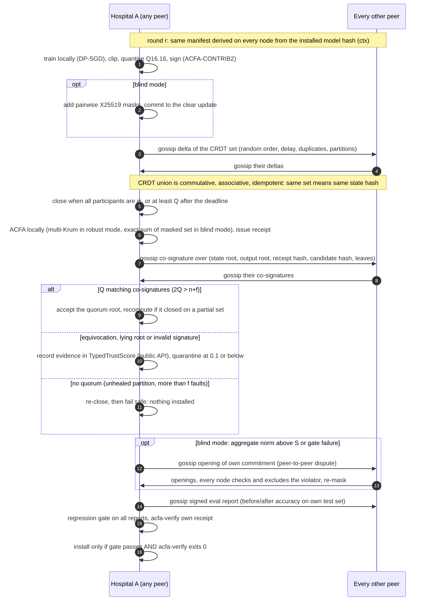
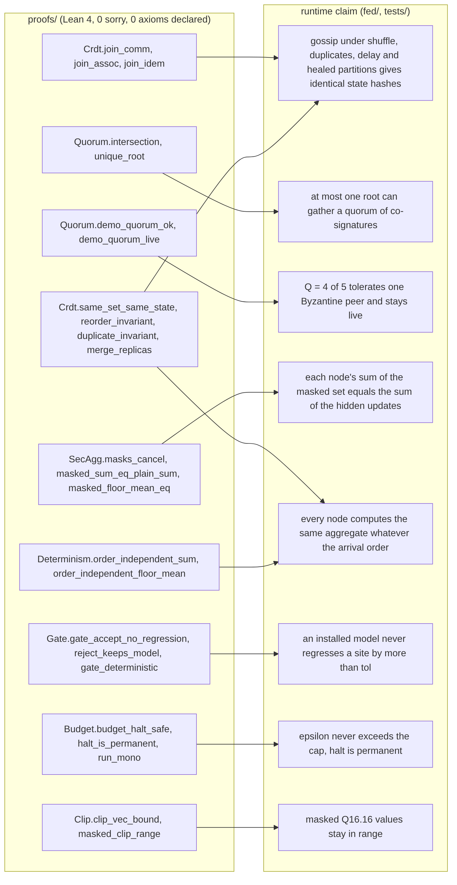

# Architecture

## System

There is no coordinator. Five hospital peers form a full mesh of direct links, and each runs the same stack: local DP-SGD training, a signed contribution, the CRDT gossip set, local ACFA aggregation, a co-signed root, the quorum check and the regression gate, then install.

Source: [diagrams/system.mmd](diagrams/system.mmd) (also [SVG](diagrams/system.svg)).

## One round

Source: [diagrams/round.mmd](diagrams/round.mmd) (also [SVG](diagrams/round.svg)).

**Close rule.** A node closes when it holds every participant's contribution, or at least Q of them after `deadline` ticks. It then issues its own receipt and co-signs. If no root gathers Q valid co-signatures within `cosig_timeout` ticks, every node re-closes on what it now holds (up to `max_close_attempts`). After that the round fails safe.

**Recovery.** A node that closed early on a partial set (a *stale* co-signature) recomputes on the quorum's leaf set once it holds those leaves. A node whose signed root is not what ACFA gives on its own declared leaves is *divergent*: that is recorded as trust evidence.

**Mesh simulation.** Ticks are logical. Each link keeps a per-link sent set and sends only the CRDT entries the peer has not been sent yet (delta anti-entropy). Delivery delays are uniform in [1, 3] ticks, with duplicates at probability 0.2. A partition is described as `{groups, from, until}`, and links across groups drop messages until the partition heals.

### Proof map: claim → mechanism → evidence → proof or test

| Claim | Mechanism | Evidence file (bundle) | Lean theorem / test |
|---|---|---|---|
| No coordinator | full mesh; every step runs on every node from its own CRDT state | `network-egress.log` (direct `A->B` links only) | `test_no_coordinator_anywhere_in_code_or_ui`; `verify_bundle`: "no coordinator…" |
| Gossip converges | grow-only set of signed envelopes (crdt-merge `CRDTMergeState`), delta anti-entropy per link | `mesh.json` (per-tick state hash per node) | `Crdt.same_set_same_state`, `Crdt.reorder_invariant`, `Crdt.duplicate_invariant`, `Crdt.merge_replicas`; `test_shuffled_duplicated_delayed_gossip_converges_to_identical_roots`, `test_partition_that_heals_still_gives_identical_roots`, `test_identical_content_gives_identical_state_hash_whatever_the_order` |
| One accepted root | quorum Q of co-signed roots, 2Q > n + f | `rounds/*/cosignatures.json` | `Quorum.intersection`, `Quorum.unique_root`, `Quorum.demo_quorum_ok`; `test_quorum_intersection_parameters`, `test_accepted_root_has_quorum_of_valid_cosignatures`; `verify_bundle` recounts the quorum |
| Fail safe without quorum | re-close, then abort; nothing installed | `model-manifest.json` | `test_partition_that_never_heals_fails_safe_without_install` |
| Divergent root / equivocation detected | root must follow from the declared leaves; two signed contributions per round are visible in the CRDT | `model-manifest.json`, `peer-trust.json` | `test_divergent_root_*`, `test_equivocation_*`, `test_a_stale_close_is_not_punished_but_a_lying_root_is` |
| Misbehaving peer quarantined | crdt-merge E4 `TypedTrustScore` (public API) | `peer-trust.json` | `test_equivocation_is_detected_through_the_crdt_and_downgrades_trust`, `test_forged_signature_downgrades_integrity_trust`, `test_trust_uses_only_the_crdt_merge_public_api` |
| No peer receives patient rows | local-only data dirs; one logged `Egress.send`; per-node DLP scan of every byte; per-link scan | `network-egress.log`, `egress-payloads/`, `local-data-manifest.json` | `test_no_peer_receives_another_nodes_raw_data`, `test_every_byte_is_scanned` |
| A leaking node is caught | canaries + record-ID/PII patterns → BLOCKED at its own gateway | `adversarial-report.json` → `canary_scan` | `test_leaky_node_is_caught_and_blocked`, `test_leaky_node_bundle_withholds_blocked_bytes`, `test_verify_bundle_detects_injected_canary` |
| Updates are attributable and bound to the round and base model | Ed25519 over (ctx = H(manifest ∋ base hash), rule, f, round, node, H(tensor)) | `rounds/*/contributions.json`, `consortium.pki` | `test_updates_are_signed_*`, `test_forged_signature_*`, `test_wrong_base_hash_*` |
| Aggregate = rule applied to the shown set; every node derives it | acfa-rs on every node; upstream `acfa-verify` before install | `rounds/*/receipt.acfa`, `verification.txt` | `Determinism.order_independent_sum`; `test_every_honest_node_verifies_its_own_receipt_before_installing` |
| Identical model on all nodes | deterministic Q16.16 aggregate → float32 install → sha256 | `model-manifest.json` → `installed_hashes`, `receipt_sha256_per_node` | `Determinism.order_independent_*`; `test_independent_verifier_accepts_and_all_nodes_install_identical_hash` |
| Tampering is detected | receipt bytes, model, PKI, manifest, co-signature, budget, log | `verification.txt` | `test_tampering_fails[*]`, `test_verify_bundle_detects_tampering[*]` |
| Poisoning outlier is not used (robust mode) | ACFA multi-Krum f = 1 (keeps n − f − 2) | `adversarial-report.json`, `evaluation.json` → `selection_counts` | `test_poisoning_attacker_is_rejected_by_krum`, `test_selection_counts_are_reported_per_site` |
| Peers can't read updates (blind mode); every node sums the masked set | pairwise X25519 masks, integer, no modulus | `rounds/*/contributions.json` (masked only) | `SecAgg.masks_cancel`, `SecAgg.masked_floor_mean_eq`; `test_blind_mode_*` |
| Masked values fit Q16.16 | clip ‖Δ‖ ≤ S, masks in [−R, R) | `model-manifest.json` → secagg R | `Clip.masked_clip_range`, `test_noised_update_fits_q16_16` |
| Out-of-bound attacker in blind mode is identified | signed commitment; peer-to-peer commit-and-open (not ZK) | `model-manifest.json` → `disputes` | `test_blind_out_of_bound_attacker_found_by_dispute_and_excluded` |
| No regression beyond tol | signed eval reports gossiped; gate on every node; rollback on fail | `evaluation.json`, `rounds/*/eval-reports.json` | `Gate.gate_accept_no_regression`, `Gate.gate_deterministic`; `test_gate_is_applied_by_every_node_identically` |
| Record-level leakage bounded by ε | DP-SGD + RDP accountant | `privacy-budget.json` | `test_rdp_accountant_matches_opacus`; `verify_bundle` recomputes ε |
| Budget cap halts training | refuse any round whose projected ε > cap | `privacy-budget.json` → `halted` | `Budget.budget_halt_safe`, `Budget.halt_is_permanent`, `test_budget_cap_halts_training` |
| Protection is causal | attacks with and without DP or masking | `membership-inference.json`, `privacy-attacks.json` | `test_worst_case_mia_protection_is_causal`, `test_gradient_inversion_*` |

**Who does what:**
- **acfa-rs** (unmodified dependency) does all aggregation arithmetic, the receipts and the verification, on every node.
- **crdt-merge** (PyPI dependency) supplies the CRDT gossip state (`CRDTMergeState`) and the peer-trust scores (`TypedTrustScore`, E4 public API). It does no aggregation arithmetic.
- **This repository** supplies the mesh simulation, co-signature quorum, divergence/equivocation classification, gate, DP accounting, secure-aggregation masks, evidence bundle and proofs.

## Component roles, as used

| Component | Used for | Not used |
|---|---|---|
| **acfa-rs** `d19fb56` (Apache-2.0, unmodified) | on every node: Q16.16 integer aggregation (multi-Krum; select-all band for blind mode), Ed25519 contribution check, equivocation conviction, receipt issue/resolve (`bridge/` links `acfa-receipt` + `acfa-aggregate`), upstream `acfa-verify` CLI | Bulyan, the finality layer, the Python `acfa-flower` package |
| **crdt-merge** 0.11.0 (BSL 1.1, PyPI) | `CRDTMergeState`: the gossip set of signed envelopes (contributions, co-signatures, eval reports, dispute openings) and its `state_hash`; `TypedTrustScore` (E4 public API) for peer trust evidence and quarantine | aggregation arithmetic (all of it is acfa-rs), model-merge strategies |
| **this repo** | mesh simulation, close rule, co-signature quorum, stale/divergent classification, DP-SGD + RDP accountant, pairwise masking + peer-to-peer disputes, egress/DLP, synthetic data, attacks, bundle, verifier, UI, Lean proofs | — |

## Blind-mode details

- **Masks:**
  - node *i* adds Σ_{j>i} m_ij − Σ_{j<i} m_ji, where m_ij = SHAKE-256(HKDF(X25519(i, j), ctx)) mapped to integers in [−R, R);
  - R = (2³¹ − 1 − 2²¹)/(n − 1), so masked values stay inside ACFA's Q16.16 range (`Clip.masked_clip_range`);
  - no modulus is used, so the floor-mean that **each node** computes over the masked set equals the floor-mean of the hidden updates (`SecAgg.masked_floor_mean_eq`).
- **Dropouts and blocked, invalid or convicted contributions:** every node moves to a new attempt (`acfa_round = round·100 + attempt`, new ctx), re-masked over the survivors. All honest nodes derive the same survivor set from the same CRDT state. If they disagree (a partition), the co-signature quorum decides.
- **Disputes:** triggered when the aggregate norm exceeds S, or when the gate fails.
  1. Every participant gossips its opening (Δ, r, pair seeds) to **all peers**.
  2. Every honest node checks the signed commitment, masked − mask = Δ, seed consistency and ‖Δ‖ ≤ S itself, and reaches the same verdict.
  3. Violators are excluded and quarantined.
- **Not zero-knowledge:** in a dispute, all peers see that attempt's DP-noised updates. Production path: ZK range/norm proofs (RoFL, ELSA, Bulletproofs).
